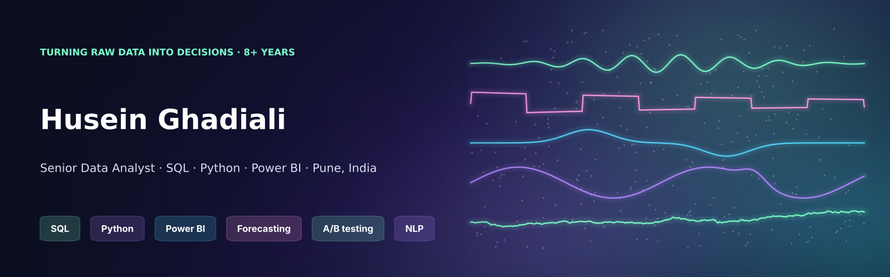

  
  
  

### Hi, I'm Husein 👋

I'm a data analyst with **8+ years** across US healthcare, B2B manufacturing and wholesale distribution. I turn raw operational data
into SQL/Python pipelines and Power BI / Tableau dashboards that leadership runs the business on. MS Business Analytics (GPA 3.97).

- 🏥 Cut patient complaints **12%** with a text-mining pipeline over 10K+ reviews, and reduced average patient wait time by **15 minutes** with Tableau dashboards
- 📊 Halved ad-hoc reporting requests with a self-service **Power BI** suite, and shortened the monthly reporting cycle **20%** with Python pipelines tested in CI
- 🛒 Improved marketing ROI **20%** with RFM segmentation
- 📦 Recently shipped a Python order tool for a US wholesale client, integrating a vendor ERP API (53 automated checks)

---

### 🚀 Featured projects

Each project has a business question, an India-relevant dataset, tested code, CI and a findings-first README.

| | Project | What it shows | Stack |
|---|---|---|---|
| 🛵 | **[Quick-Commerce SQL Analytics](https://github.com/HuseinGhadiali/quick-commerce-sql-analytics)** | 25 business questions on 451K orders across 8 Indian cities: cohorts, RFM, basket analysis, delivery SLAs and unit economics. Verified on PostgreSQL 16 and DuckDB | SQL · PostgreSQL · DuckDB |
| 🏥 | **[Hospital Operations Analytics](https://github.com/HuseinGhadiali/hospital-operations-analytics)** | Messy HIS extracts → data-quality gates → **Power BI star schema + 38 DAX measures**. Covers OPD waits, bed occupancy, TPA/PM-JAY claim leakage | Python ETL · Power BI · SQL |
| 🛍️ | **[Customer Segmentation & CLV](https://github.com/HuseinGhadiali/ecommerce-customer-segmentation)** | D2C brand: RFM playbook, cohort retention, **COD/RTO economics**, LTV:CAC and a predictive CLV model | pandas · scikit-learn |
| 📈 | **[Demand Forecasting & Inventory](https://github.com/HuseinGhadiali/fmcg-demand-forecasting)** | 120 FMCG series: ETS/Theta/MSTL/Croston vs a **global LightGBM**, rolling backtests, Diwali effects, **23% less stock at the same fill rate** | statsforecast · mlforecast |
| 💳 | **[UPI Cashback A/B Test](https://github.com/HuseinGhadiali/upi-cashback-ab-test)** | 200K-user experiment: power, **SRM root-causing**, CUPED, Holm-corrected segments, novelty and an ROI rollout decision | SciPy · SQL · experimentation |
| 💬 | **[Customer Voice NLP](https://github.com/HuseinGhadiali/customer-voice-nlp)** | 🤗 Transformers on real Flipkart reviews and banking support tickets: sentiment, zero-shot aspects, topic discovery, **fine-tuned DistilBERT** routing | Hugging Face · PyTorch |
| 🏦 | **[Credit Risk ML Toolkit](https://github.com/HuseinGhadiali/credit-risk-ml-toolkit)** | **LazyPredict → Optuna → calibration → SHAP → fairlearn**, plus Gini/KS, a CIBIL-style 300–900 score and PSI | LightGBM · Optuna · SHAP |

<b>Earlier work</b>

| Project | Summary |
|---|---|
| [CFPB Issues Prediction](https://github.com/HuseinGhadiali/CFPB_Issues_Prediction) | Classifying consumer-finance complaints: TF-IDF models vs fine-tuned DistilBERT (73% accuracy) |
| [Corona Industrial Review Analysis](https://github.com/HuseinGhadiali/Corona_Industrial-Review-Analysis) | Voice-of-customer for a manufacturer: VADER + transformer sentiment, aspects, competitor mentions |
| [Geospatial Retail Optimization](https://github.com/HuseinGhadiali/Geospatial-Data-Analysis-for-Retail-Optimization) | NYC store-location analysis with GeoPandas and Folium ([live map](https://huseinghadiali.github.io/Geospatialwebsitehost/index.html)) |
| [Amazon Scraper & Chatbot](https://github.com/HuseinGhadiali/Amazon-Web-Scraper-and-Chatbot) | Selenium scraper + LangChain RAG chatbot over the scraped catalogue |
| [NCAA March Madness 2025](https://github.com/HuseinGhadiali/NCAA_Basketball_Kaggle_MM2025) | Kaggle EDA and team-perspective modelling |
| [Material Band-Gap Prediction](https://github.com/HuseinGhadiali/Material-Band-Gap-Prediction) | Streamlit app predicting band gaps with Extra Trees |

---

### 🧰 Toolbox

**Analysis & BI**
     

**Python & ML**
       

**Engineering**
     

---

  
  

<i>Open to Data Analyst / Senior Data Analyst roles in Pune, Mumbai, Bengaluru or remote. Let's talk on <a href="https://linkedin.com/in/husein-ghadiali">LinkedIn</a>.</i>

